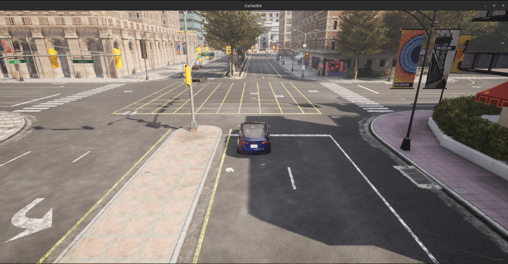
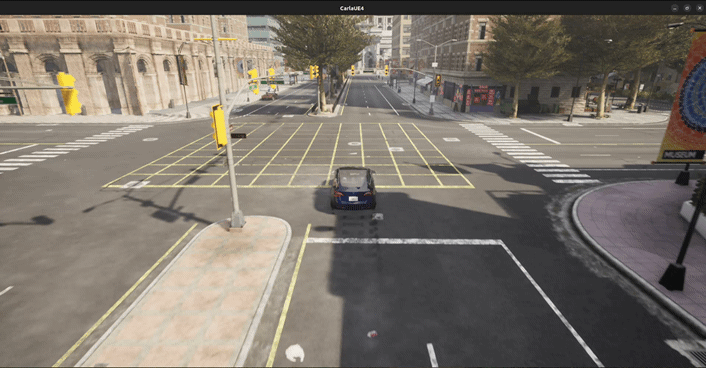
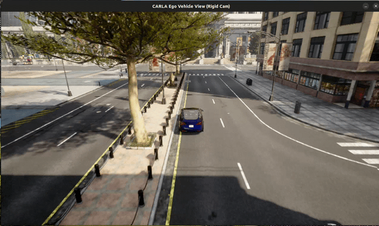
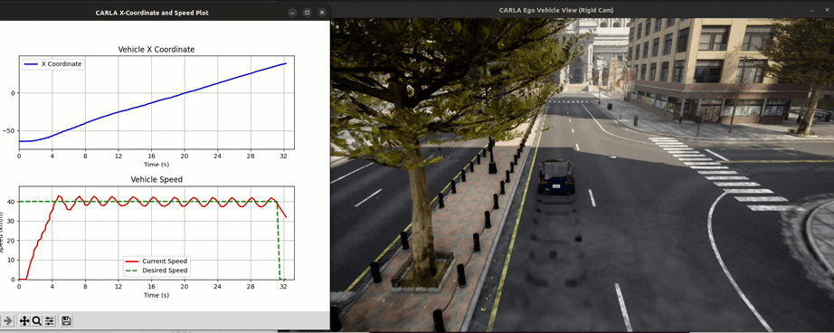
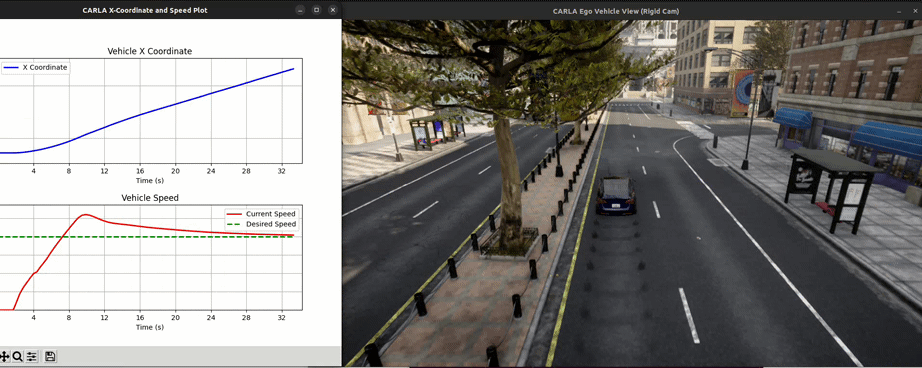
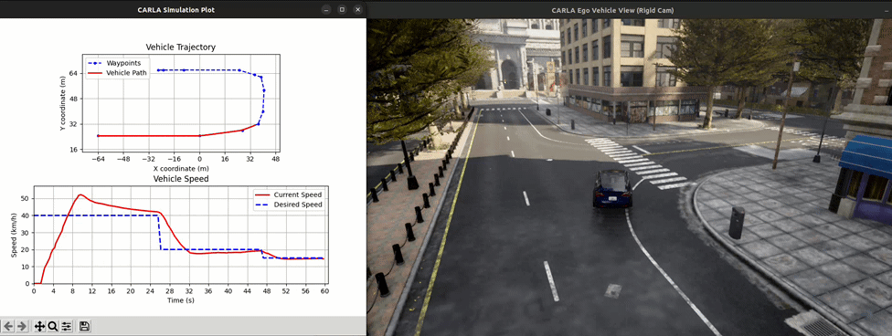
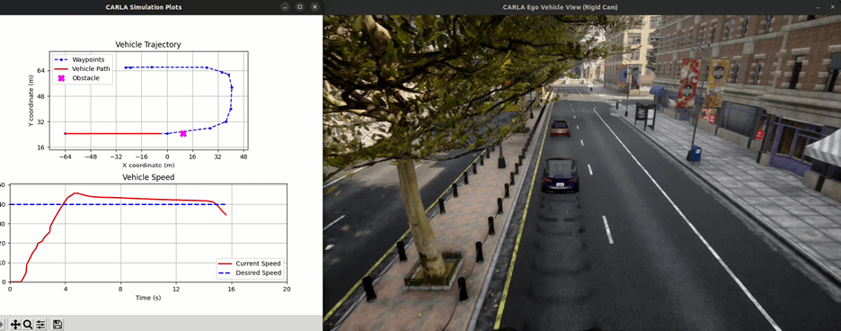

## 🎥 Visual Demonstrations

Here is the visual progression of the autonomous driving scripts (`cr_1` to `cr_7`):

### Basic Spawning & Control (`cr_1` to `cr_3`)
<table>
  <tr>
    <td align="center"><b>cr_1: Spawn</b></td>
    <td align="center"><b>cr_2: Tracking</b></td>
    <td align="center"><b>cr_3: Pygame & Plot</b></td>
  </tr>
  <tr>
    <td></td>
    <td></td>
    <td></td>
  </tr>
</table>

### Autonomous Navigation & Hazard Avoidance (`cr_4` to `cr_7`)
<table>
  <tr>
    <td align="center"><b>cr_4: Waypoints</b></td>
    <td align="center"><b>cr_5: PID Speed</b></td>
    <td align="center"><b>cr_6: Stanley Steering</b></td>
    <td align="center"><b>cr_7: Obstacle Avoid</b></td>
  </tr>
  <tr>
    <td></td>
    <td></td>
    <td></td>
    <td></td>
  </tr>
</table>


## Installation

Clone the repository:

```bash
git clone [https://github.com/aparna7ap7/carla-autonomous-driving-progression.git](https://github.com/aparna7ap7/carla-autonomous-driving-progression.git)
cd carla-autonomous-driving-progression

Install the required dependencies:

pip install carla pygame matplotlib numpy

Quick Start

Make sure you have a running CARLA simulator server compatible with your environment.

Launch the CARLA simulator server:
Bash

./CarlaUE4.sh

Run any project progression script from the examples directory:
Bash

python3 examples/cr_7.py

```
